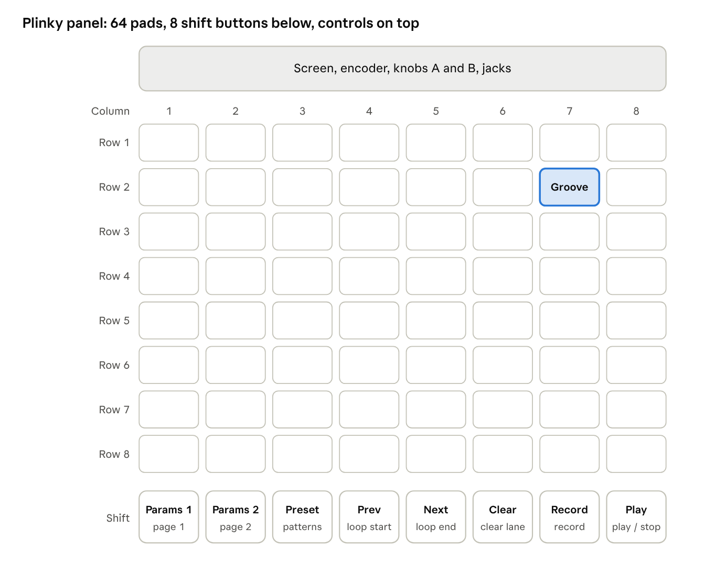
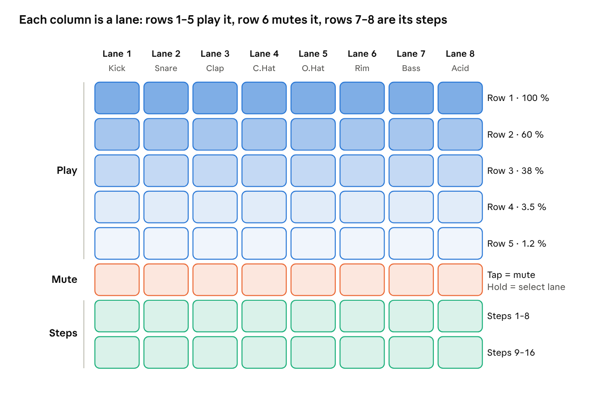
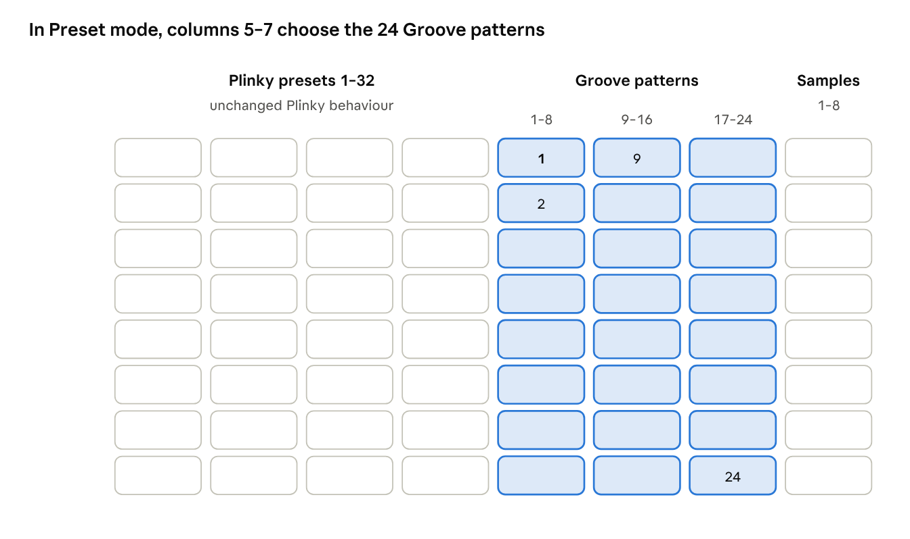
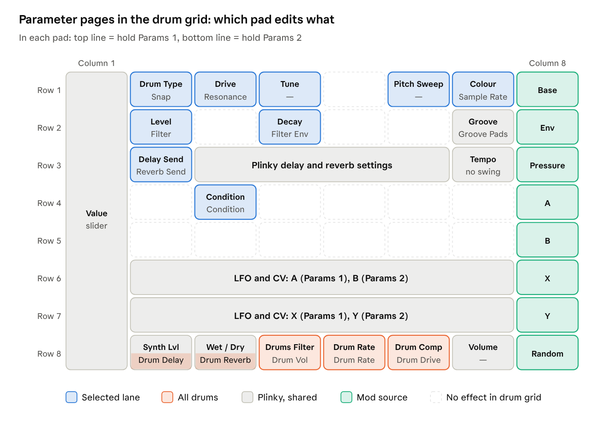

# skamba — Groovebox firmware for Plinky: User Manual (v.s-n.0.11)

skamba is an unofficial, open-source firmware for the Plinky synth. Its Groovebox mode turns the Plinky into a drum machine with an 8-lane, 64-step sequencer, while the Plinky synth keeps playing alongside it. The drums are synthesised separately, so they don't use up the synth's voices.

What you get:

- **8 drum lanes**, each with its own sound engine. There are 24 engines: kicks, snares, hats, Bass, an Acid line synth, FM and glitch sounds, LXR-based drums, and sample playback.
- **A step sequencer** with up to 64 steps per lane, a separate loop length per lane, velocity, step locks (per-step settings) and trigger conditions.
- **Sound controls per lane:** tune, decay, filter, drive, sends, and more, all on the familiar Plinky parameter pads.
- **Controls for the whole drum mix:** filter, compressor, drive, bit-crush, delay and reverb send, and volume.
- **Modulation** from Plinky's LFOs, knobs A/B, CV, the accelerometer, the hit's velocity, an envelope and randomness.
- **24 saved Groove patterns**, separate from Plinky's own presets and patterns.

**Installing.** Download the `.uf2` file from the GitHub release and flash it like any Plinky firmware update, by copying it to the Plinky's UF2 drive. The start-up screen shows a running cat and the version **v.s-n.0.11**. The Plinky always starts in normal mode; Groovebox mode is switched on by hand (see Quick start).

## The Plinky panel

This manual counts pad rows 1–8 from the top and columns 1–8 from the left. The eight shift buttons sit below the pads.

The highlighted pad (row 2, column 7) is the **Groove** pad: Params 1 + it switches Groovebox mode on or off, Params 2 + it switches the pads between drums and Plinky. The drawing is a layout guide, not to scale.

## Quick start

You can have a first beat running in about a minute:

1. Hold **Params 1** (the first shift button) and tap the blank pad in **row 2, column 7**. The screen says "groove on" and the pads become the drum grid.
2. Tap a pad in the top row to hear a lane. The default kit, left to right, is: Kick, Snare, Clap, Closed Hat, Open Hat, Rim, Bass, Acid.
3. Tap the column you want to program, then tap steps in the **bottom two rows** (16 steps).
4. Press **Play**. The drums start; press Play again to stop.
5. To change a lane's sound, hold **Params 1** or **Params 2** and touch a parameter pad, for example **Decay**. Then turn the encoder or slide on the left column.
6. To play the Plinky synth over the beat, hold **Params 2** and tap the same blank pad (row 2, column 7). The screen says "plinky pads"; do it again to get back to "drum pads".

To leave Groovebox mode, use Params 1 + that pad again ("groove off"). Your pattern is saved automatically.

## The drum grid

With Groovebox mode on, the 64 pads become the drum grid. Each column is one drum lane (the default kit is shown under the lane numbers).

- **Rows 1–5 play the lane** live, from loud (row 1) to very soft (row 5). Playing a pad also **selects** that lane: the bottom rows and all sound settings then belong to it.
- **Row 6 is the mute row.** Tap to mute or unmute a lane; hold for 0.4 s to select a lane without hearing it.
- **Rows 7–8 are the steps** of the selected lane, 16 at a time. Lit pads are active steps and a moving light shows the playhead.

Rows 4 and 5 are very quiet. Use them for ghost notes and soft hats.

## Buttons in Groove mode

The eight shift buttons along the bottom keep their printed meaning; in the drum grid they act on the drums:

| Button | Tap | Hold |
| --- | --- | --- |
| 1 ⟩⟩ Params 1 | Parameter page 1 (drum sounds) | Hold + pad = pick a setting |
| 2 ⟨⟨ Params 2 | Parameter page 2 | Hold + pad = pick a setting |
| 3 Preset | Pattern mode: choose one of 24 Groove patterns | Hold + pad = pick a pattern |
| 4 ⇤ Prev | Previous 16-step page of the selected lane | Hold + step = set the lane's loop start |
| 5 ⇥ Next | Next 16-step page | Hold + step = set the lane's loop end |
| 6 ✕ Clear | — | Hold = clear the selected lane's steps; hold again = reset its sound |
| 7 ○ Record | Record on / off (with Play = live recording) | — |
| 8 ▷ Play | Start / stop the drums | — |

In the drum grid, Play runs only the drums. In the Plinky view it runs Plinky's own sequencer as usual. If one is already running, the other starts at the next bar so they stay in time; the Play light blinks fast while it waits.

The **encoder** changes the setting you last touched. An **encoder click** sets it back to its default (for filters: off).

## Making beats

Each lane has 64 steps, one step per 16th note. The bottom two rows show 16 of them for the **selected lane**: the lane you last played, or held on the mute row.

**Steps.** Tap a step pad to turn it on or off. How hard you tap sets the step's velocity.

**Live recording.** Press **Record**, then **Play**. Everything you hit on rows 1–5 is written to the nearest step, at that row's velocity. A hit late in a step goes on the next step and isn't played twice. Press Record again to stop recording.

**Pages.** Short press **Prev** or **Next** to see steps 17–32, 33–48 and 49–64. You can only page through steps inside the lane's loop.

**Loop length per lane.** Hold **Prev**: all 64 pads now show the selected lane's 64 steps (row by row). Tap a pad to set where the loop starts. Hold **Next** and tap to set where it ends. Hold the pad instead of tapping to set it for **all lanes**. Different lengths per lane give polyrhythms, for example a 12-step hat over a 16-step kick.

**Step locks (per-step settings).**

1. Long press a step (0.4 s). It blinks; an empty step gets a hit.
2. Change any drum setting: the change applies **only to this step**, for example a higher tune or a longer decay on one hit.
3. Long press the step again to finish. Locked steps flicker.

An encoder click in step lock mode clears that step's locks. Turning a locked step off also clears them. A pattern holds up to 48 locks.

**Conditions.** In step lock mode, hold a shift button and touch an **Order** pad (Arp or Seq row) to pick **Condition**, then turn the encoder:

| Condition | The step plays… |
| --- | --- |
| always | every time (default) |
| 25 % / 50 % / 75 % | at random, with that chance |
| 1:2, 2:2, 1:3 … 4:4 | on that loop out of every 2, 3 or 4 loops of the lane |
| 1st / not 1st | only on the first loop after Play / on every loop but the first |

**Clearing.** Hold **Clear**: the selected lane loses its steps, locks and conditions, and its loop goes back to 1–16. Hold Clear again on the empty lane to reset its sound to the engine's default and remove its modulation.

## Patterns and saving

A Groove pattern holds everything on the drum side: the 8 lanes' sounds and steps, loops, step locks, conditions, modulation and the all-drums settings. There are 24 pattern slots, separate from Plinky's own presets and patterns.

- **Choose a pattern:** tap **Preset**, then a pad in columns 5–7. Patterns are numbered down each column: column 5 holds 1–8, column 6 holds 9–16, column 7 holds 17–24. While the drums play, the change waits for the end of the bar. Tap Preset again to leave.
- **Copy:** long press a pattern pad to copy the current pattern into that slot ("groove copied").
- **Clear a pattern:** in Preset mode, hold **Clear**.
- **Saving is automatic.** Changes are stored a few seconds after you stop editing; there is no save button.
- **At power-on** the Plinky starts in normal mode with Groove pattern 1 loaded.

In the Plinky view, Preset mode is plain Plinky: columns 5–7 choose Plinky's own melody patterns.

## Shaping sounds

In the drum grid, Plinky's printed parameter pads edit the **selected lane's** sound. Hold **Params 1** or **Params 2** and touch a pad, then turn the encoder or slide on column 1. Tap Params 1 or 2 without touching a pad to keep the page open.

| Setting | What it does |
| --- | --- |
| Drum Type | Which of the 24 engines the lane uses (see Drum types) |
| Tune | Pitch, ±2 octaves in semitone steps |
| Pitch Sweep | How far and how fast the pitch drops at the hit |
| Decay | Length of the sound |
| Snap | Click, noise or accent at the start, depending on the engine |
| Colour | The engine's main tone control (see Drum types) |
| Drive | Distortion on this lane |
| Level | Volume of this lane |
| Filter | Resonant filter: left = low-pass, middle = off, right = high-pass |
| Resonance | Filter resonance |
| Filter Env | Filter movement per hit: right = starts brighter and closes, left = starts darker and opens |
| Sample Rate | Lo-fi sample-rate reduction on this lane |
| Delay / Reverb Send | How much of this lane goes into Plinky's delay and reverb |
| Condition | When a locked step plays (step lock mode only, see Making beats) |

An encoder click resets the setting (filters go back to off). In step lock mode, every change is stored on the locked step instead of the lane.

Bass and Acid follow Plinky's **scale**, which is set in the Plinky view (Params 2 + Octave pad).

## Drum types

Every lane can use any of 24 engines. Select the lane, then choose **Drum Type** (Params 1 + Shape pad) and turn the encoder. The engines are listed in this order:

| Drum type | Sound | Colour does |
| --- | --- | --- |
| Kick | Classic sine kick with a pitch drop | Tone |
| Kick2 | Punchier kick: fast snap, body sweep, saturation | Tone |
| Snare | Drum heads plus noise wires | Tone ↔ noise |
| Clap | Four quick noise bursts | Tone |
| C.Hat | Closed hat; chokes the Open Hat | Tone |
| O.Hat | Open hat | Tone |
| Cymbal | Long metallic wash | Tone |
| Rim | Rimshot | Rimshot ↔ clave |
| Cowbell | Two square tones, band-passed | Tone |
| Tom | Tom with an overtone | Tone |
| Bass | Bass note in Plinky's key (see Bass and Acid) | Harmonics |
| Acid | 303-style acid synth line (see Bass and Acid) | Saw ↔ square |
| FM | Two-operator FM bell and percussion | FM ratio |
| Clang | Metallic, inharmonic FM | Metal |
| Zap | Very fast, huge pitch sweep | Sweep time |
| Chirp | Upward laser sweep | Speed |
| Fold | Wavefolded sine with a pitch drop | Amount of folding |
| Glitch | Different random blip on every hit | Randomness |
| Crush | Bit-crushed ring-mod tone and noise | Crush |
| LXR Drum | FM sine drum: kicks, toms, booms | FM amount |
| LXR Snare | Sine plus noise snare | Tone ↔ noise |
| LXR Hat | FM-metal hat; chokes other LXR Hats | FM amount |
| LXR Cymbal | FM-metal cymbal | FM amount |
| Sample | Plays the lane's slice of the current Plinky preset's sample | — |

When you switch a lane to a new type, the sound settings stay as they were, so a new type can sound unusual at first (Bass and Acid are the exception: coming from a drum type, they load their own starting sound). Hold **Clear** twice on an empty lane to load the type's own default sound.

**LXR models.** The four LXR types are simplified ports of drum algorithms from the open-source LXR-02 firmware (see Credits). On them:

- **Pitch Sweep** sets the depth and length of the pitch drop. On LXR Hat and LXR Cymbal it spreads the metallic overtones instead.
- **Snap** adds a click at the start of the hit.
- **Drive** uses the LXR's own distortion curve.
- **LXR Hat** on two lanes, one with a short Decay and one with a long Decay, gives you a closed and open hat that choke each other.

## Bass and Acid lanes

Bass and Acid play notes in the same key as the Plinky synth. Their pitch snaps to the scale set on the Plinky and follows its **Pitch** transpose; Tune 0 is the scale's root. With a C scale on the Plinky, a Bass lane plays C.

**Bass** is a round, wavefolded bass note. It holds for the Decay time and then releases, so Decay sets the note length. Colour adds harmonics, Pitch Sweep adds punch, Snap adds a low thump. To make a bass line, lock **Tune** on single steps (step lock mode); each locked note is snapped to the scale.

**Acid** is a 303-style line synth: saw or square wave into a resonant ladder filter, with accents and slides.

**Getting an acid line.** Choose **Acid** as the Drum Type and leave it there for half a second. The screen says "acid line / new notes" and the lane gets a new 64-step line:

- about two thirds of the steps play, always including the first;
- notes move around the root across **three octaves**;
- about a quarter of the steps are **accented** and a quarter **slide** into the next note.

Scrolling past Acid doesn't change anything. For a different line, choose another type (for example Bass) and come back to Acid. The lane's old step locks are removed.

**Acid controls:**

| Control | On an Acid lane |
| --- | --- |
| Filter | Cutoff |
| Resonance | Up to self-oscillation |
| Filter Env | Envelope depth (positive = classic sweep down) |
| Decay | Envelope time and how fast held notes fade |
| Snap | Accent strength |
| Pitch Sweep | Slide time |
| Colour | Saw ↔ square |
| Drive | Extra grit |

Turn **Decay** low for short plucks. At maximum, notes hold at full level for as long as they're held.

A step you tap on an Acid lane plays the root, at normal octave, without accent. Hitting the Acid lane on rows 1–5 plays its root note live.

## All-drums controls

The bottom row of the parameter pages (Plinky's mixer row) holds the controls for the whole drum mix. They're saved with each pattern.

| Bottom-row pad | With Params 1 | With Params 2 |
| --- | --- | --- |
| 1 Synth / Input | Plinky synth level | **Drum Delay**: whole drum mix into the delay |
| 2 Wet-dry / Input→FX | Plinky wet / dry | **Drum Reverb**: whole drum mix into the reverb |
| 4 HPF | **Drums Filter**: DJ filter, low-pass ← off → high-pass | **Drum Vol** |
| 5 (blank) | **Drum Rate**: sample-rate reduction | **Drum Rate** |
| 6 | **Drum Comp**: compressor (kicks bypass it) | **Drum Drive**: overdrive and wavefolding |

- **Drum Vol** works in both views. It goes back to 50 % every time you switch Groovebox mode on.
- **Drum Delay / Drum Reverb** are added to each lane's own delay and reverb sends. They use Plinky's delay and reverb, so the Delay and Reverb pages (time, feedback, and so on) shape them.
- **Drums Filter** is at the middle (off) by default. An encoder click sets it back to off.
- New patterns start with the compressor at 30 %.

The Plinky synth's level defaults to 22 % in this firmware, so it sits well against the drums.

## Modulation

Drum settings are modulated the same way as Plinky's own parameters:

1. Hold **Params 1** or **Params 2** and touch a drum setting, for example Filter.
2. Tap a source in the **right-hand column** (column 8).
3. Turn the encoder to set how much that source moves the setting. Negative amounts move it the other way.

| Column 8 row | Source |
| --- | --- |
| 1 Base | The setting itself (no modulation) |
| 2 Env | Jumps up at each hit of the lane and falls back over one 16th note |
| 3 Pressure | The velocity of the hit |
| 4 / 5 A / B | Knob A / B, plus CV input and LFO A / B |
| 6 / 7 X / Y | CV input, LFO X / Y and the accelerometer |
| 8 Random | A new random value at each hit. On Tune, the random notes stay in Plinky's scale |

Sources also work on the all-drums controls (Drums Filter, Drum Vol, Comp, Drive, Rate, Drum Delay, Drum Reverb). There, Env, Pressure and Random follow the latest hit of any lane.

Hold the encoder down until the screen asks "Clear Mod?" to remove all modulation from the selected setting. A pattern holds up to 24 modulation slots.

If modulation seems to do nothing:

- **LFOs start at depth 0.** Turn up **Depth** on the A, B, X or Y row first.
- **The accelerometer reacts to movement**, not to a held tilt: its value returns to the middle when the Plinky stops moving.
- **Some settings change only at the hit:** Drum Type, Tune, Pitch Sweep, Decay, Snap and Colour. Level, Drive, sends, Filter, Resonance, Filter Env and Sample Rate also move while a hit is still ringing.

## Playing the Plinky synth with the drums

Switch to the Plinky view with **Params 2 + the blank pad in row 2, column 7** ("plinky pads"). The drums keep playing. Everything in this view is normal Plinky: playing, presets, its own sequencer, arpeggiator, latch and recording.

- **Voices.** In Groovebox mode the synth plays up to 4 notes at once; a new note replaces the oldest. The drums have their own 6 voices.
- **Tempo and clock.** Drums and synth share Plinky's tempo (Tempo pad on the FX row) and its external clock, MIDI clock and MIDI start/stop.
- **Starting both.** Start the drums with Play in the drum grid and Plinky's sequencer with Play in the Plinky view. The second one waits for the next bar.
- **Effects.** Drums and synth share Plinky's delay and reverb. The drums have their own sends, so the synth's send settings don't change the drums.

In the drum grid, only pads that make sense for drums respond: drum settings, the Delay and Reverb rows, Tempo, the LFO / CV rows, and the mixer row. Plinky-only pads (sound, envelope, arp, sampler) do nothing there; switch to the Plinky view to change them.

## The screen

In the drum grid, the screen shows:

- **Top left:** the selected lane and its drum type, for example "8 Acid". While you change a setting, its name and value show here.
- **Bottom:** eight small level meters, one per lane. A muted lane's meter is dotted; the selected lane is underlined.
- **Right:** a cat and a boombox. The cat dances to the beat, jumps on kicks and winces at other loud hits. It stands still when the drums are stopped.
- **Status**, in place of the boombox: a record symbol while recording, ">bar" while a start waits for the next bar, or a pending pattern change.

| Message | Meaning |
| --- | --- |
| groove on / groove off | Groovebox mode switched |
| drum pads / plinky pads | Pads switched between drum grid and Plinky |
| acid line / new notes | A new acid line was made |
| steps cleared / sound reset | First / second hold of Clear |
| Lock step N | Step lock mode on step N |
| locks full / mod slots full | The pattern has no room for more step locks (48) or modulations (24) |
| groove copied | Pattern copied to another slot |

## CPU limits and overload guard

The Groovebox plays up to 6 drum voices at once, and the Plinky synth is limited to 4 voices while Groove mode is on. Kicks are never cut off to make room.

**Overload guard.** With many long sounds playing, the Plinky's processor can run out of time, which used to cause glitches or a frozen screen. Now, when it gets close to the limit, the quietest drum voice fades out quickly instead. Kicks, LXR Drum, Bass and Acid are never faded this way. If you hear sounds cut short in very busy patterns, shorten some Decay times or use fewer long cymbals and open hats.

## Version history

| Version | Changes |
| --- | --- |
| v.s-n.0.11 | Five velocity rows again (the test keyboard row was removed) |
| v.s-n.0.10 | Acid lines over three octaves, Acid Decay fades held notes, quieter bottom velocity rows |
| v.s-n.0.9 | Bass and Acid play in Plinky's key and follow its transpose |
| v.s-n.0.8 | Drum Delay and Drum Reverb, working Env modulation, every source on the all-drums controls |
| v.s-n.0.7 | Overload guard |
| v.s-n.0.3–0.6 | LXR Drum, LXR Snare, LXR Hat, LXR Cymbal |
| v.s-n.0.2 | Plinky synth level defaults to 22 % |
| v.s-n.0.1 | First Groovebox release |

## Credits and licence

- skamba is a modified, unofficial firmware for the Plinky synth, based on the open-source Plinky firmware (MIT licence) by mmalex and the Plinky community.
- The LXR Drum, LXR Snare, LXR Hat and LXR Cymbal models are based on algorithms from the LXR-02 firmware by Erica Synths, released under the GNU General Public License v3 (GPL-3.0).
- Because it includes this code, the firmware as a whole is distributed under GPL-3.0. The licence and notice files are in [`sw/lxr_license/`](../../sw/lxr_license/).
- This firmware is **not made, approved or supported by Erica Synths** or by the makers of the Plinky. "Plinky" is the name of the original instrument; "LXR" and "LXR-02" are names of Erica Synths. These names are used here only to describe compatibility and where the algorithms come from.
